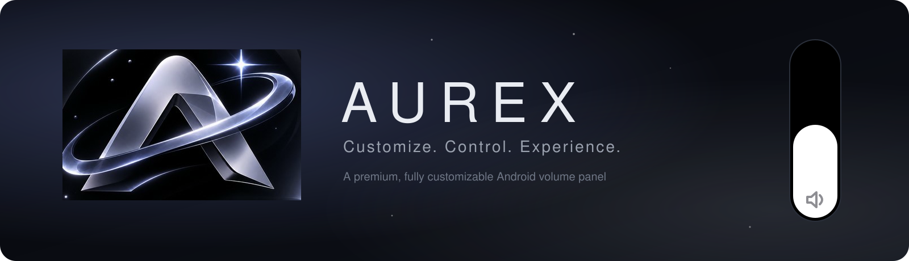
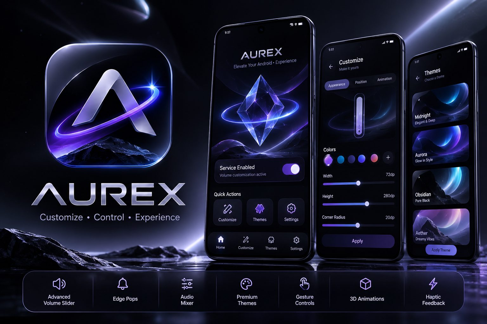
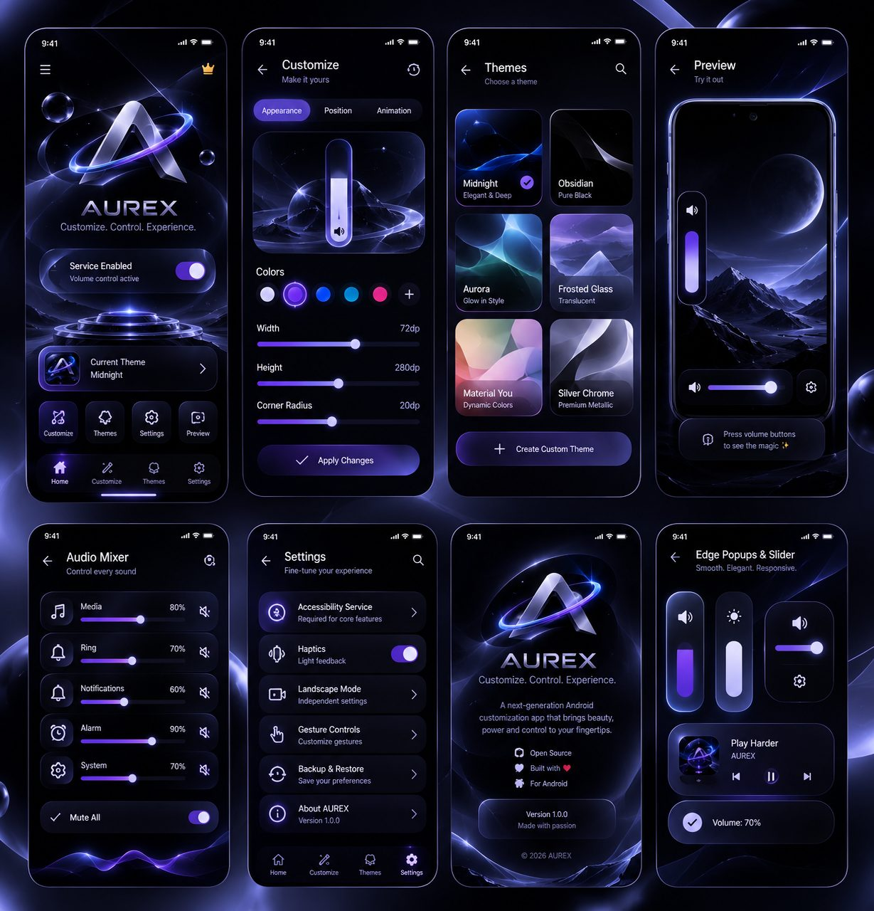

<div align="center">

<br>
<p align="center">
<a href="https://github.com/Umangnamdeo/AUREX/releases"></a>
<a href="https://github.com/Umangnamdeo/AUREX"></a>
<a href="https://github.com/Umangnamdeo/AUREX/issues"></a>
<a href="https://github.com/Umangnamdeo/AUREX/blob/main/LICENSE"></a>
</p>
<p align="center">


</p>
</div>
##Website
https://umangnamdeo.github.io/AUREX/
<h3 id="overview"><picture><source media="(prefers-color-scheme: dark)" srcset="assets/readme/dark/h-overview.svg"></picture></h3>
AUREX is an open-source Android app that replaces the stock volume panel with a sleek, fully customizable one. Press the volume buttons and a slim pill slides in from the edge of your screen. Drag it to set the volume, tap the speaker to mute, or long-press it to open a full audio mixer.
You choose how it looks and behaves: four styles, eight built-in themes plus your own, and control over size, position, colors, animation and haptics. The app itself is a dark, atmospheric Jetpack Compose interface with an interactive 3D volume orb. There are no ads and no accounts.
<table width="100%"><thead><tr><th align="left" width="28%">Quick facts</th><th align="left">Details</th></tr></thead><tbody>
<tr><td><b>App name</b></td><td>AUREX (<code>com.umang.aurex</code>)</td></tr>
<tr><td><b>Platform</b></td><td>Android 10 and above (API 29+)</td></tr>
<tr><td><b>Price</b></td><td>Free and open source, no ads</td></tr>
<tr><td><b>Volume UI</b></td><td>Edge Volume Island, edge pops, audio mixer</td></tr>
<tr><td><b>Styles</b></td><td>Classic (default), Glass, Aurex, Minimal</td></tr>
<tr><td><b>Themes</b></td><td>8 built-in, plus custom themes you can save, import and export</td></tr>
<tr><td><b>Design</b></td><td>Jetpack Compose, dark glass UI, animated atmosphere and 3D orb</td></tr>
<tr><td><b>Updates</b></td><td>Checks GitHub on launch and from Settings</td></tr>
<tr><td><b>License</b></td><td>Apache License 2.0</td></tr>
</tbody></table>
<h3 id="get"><picture><source media="(prefers-color-scheme: dark)" srcset="assets/readme/dark/h-get.svg"></picture></h3>
<div align="center">
Action	Link
Download APK	GitHub Releases
Report an issue	GitHub Issues
Contribute	Pull requests
Source code	Umangnamdeo/AUREX
License	Apache-2.0
</div>
Install: download the APK from Releases and open it. Then open AUREX, tap Enable accessibility service, and switch AUREX on. On Android 13 and newer, an app installed from outside the Play Store first needs App info, menu (three dots), Allow restricted settings before the accessibility toggle becomes available.
<h3 id="design"><picture><source media="(prefers-color-scheme: dark)" srcset="assets/readme/dark/h-design.svg"></picture></h3>
These are design concept renders that guided the interface. They are not screenshots of the finished app, which will differ in details.
<div align="center">

<br><br>

</div>
<h3 id="features"><picture><source media="(prefers-color-scheme: dark)" srcset="assets/readme/dark/h-features.svg"></picture></h3>
	
Edge Volume Island	A vertical pill on the screen edge that slides in with a spring animation, fills as volume rises, and fades out after a timeout
Edge pops	Small animated bars for Volume Up and Volume Down, each with its own color and size
Audio mixer	Media, Ring, Notification, Alarm and System volumes with live sync and mute buttons
Customization studio	Live phone preview with colors, dimensions, position, animation and haptics
Theme engine	Midnight, Obsidian, Pure Black, Frosted Glass, Aurora, Material You, Monochrome, Silver Chrome, and your own
Gestures	Tap, double tap and long press on the speaker icon run actions you choose
Landscape options	Turn the island and pops on or off in landscape and pick the side
Haptics	Off, light, medium or strong feedback
Backup and restore	Copy all settings and custom themes as text, paste them back anywhere
Update checker	A popup when a new version is published, plus a manual check in Settings
<h3 id="island"><picture><source media="(prefers-color-scheme: dark)" srcset="assets/readme/dark/h-island.svg"></picture></h3>
<table width="100%"><thead><tr><th align="left" width="28%">Feature</th><th align="left">Details</th></tr></thead><tbody>
<tr><td><b>Buttons</b></td><td>Volume Up and Down change the media volume and show the island. During calls AUREX leaves the keys to the system.</td></tr>
<tr><td><b>Touch</b></td><td>Drag or tap the pill to set the volume. The speaker icon is a separate tap target.</td></tr>
<tr><td><b>Icon gestures</b></td><td>Single tap, double tap and long press can mute, open the mixer, jump to max or minimum, or do nothing.</td></tr>
<tr><td><b>Styles</b></td><td><b>Classic</b> black pill with white fill (default) · <b>Glass</b> translucent · <b>Aurex</b> metallic with blue light · <b>Minimal</b> simple monochrome.</td></tr>
<tr><td><b>Layout</b></td><td>Left or right edge, width, height, vertical offset, corner radius, opacity.</td></tr>
<tr><td><b>Motion</b></td><td>Slide-in spring, animated fill, fade-out, adjustable duration and display time. A reduce-motion switch turns them off.</td></tr>
<tr><td><b>Sync</b></td><td>The island follows volume changes made elsewhere while it is on screen.</td></tr>
</tbody></table>
<h3 id="mixer"><picture><source media="(prefers-color-scheme: dark)" srcset="assets/readme/dark/h-mixer.svg"></picture></h3>
The mixer controls five Android audio streams independently: Media, Ring, Notification, Alarm and System. It opens from the island (long press by default) or from the Home screen. Tap outside the overlay to close it. Ring and notification volume can be blocked while Do Not Disturb is on, so AUREX offers an optional Do Not Disturb access shortcut for those sliders.
<h3 id="themes"><picture><source media="(prefers-color-scheme: dark)" srcset="assets/readme/dark/h-themes.svg"></picture></h3>
<table width="100%"><thead><tr><th align="left" width="28%">Feature</th><th align="left">Details</th></tr></thead><tbody>
<tr><td><b>Built-in themes</b></td><td>Midnight · Obsidian · Pure Black · Frosted Glass · Aurora · Material You (wallpaper colors on Android 12+) · Monochrome · Silver Chrome</td></tr>
<tr><td><b>Custom themes</b></td><td>Save the island's current look, update it later, delete it, or share it.</td></tr>
<tr><td><b>Import and export</b></td><td>Themes are copied as text to the clipboard and can be pasted into another phone.</td></tr>
<tr><td><b>Colors</b></td><td>Background, fill, icon and accent colors via swatches or hex codes.</td></tr>
<tr><td><b>Live preview</b></td><td>An interactive phone preview uses the same island component as the real overlay.</td></tr>
</tbody></table>
<h3 id="updates"><picture><source media="(prefers-color-scheme: dark)" srcset="assets/readme/dark/h-updates.svg"></picture></h3>
AUREX checks `version.json` in this repository each time it opens. If the published `versionCode` is higher than the installed app, an Update available popup appears with the changelog and an Update button that opens the APK link. You can also check manually in Settings, Updates, and switch the launch check off there.
To publish a new version (maintainer):
Raise `versionCode` and `versionName` in `app/build.gradle.kts`.
Build the signed release APK and upload it to a GitHub Release tagged `v<versionName>` as `aurex-<versionName>.apk`.
Update `version.json` with the same numbers, the APK link and a changelog, then push to `main`.
An update installs over the old app only when both APKs are signed with the same key, so keep the keystore safe.
<h3 id="privacy"><picture><source media="(prefers-color-scheme: dark)" srcset="assets/readme/dark/h-privacy.svg"></picture></h3>
<table width="100%"><thead><tr><th align="left" width="28%">Permission</th><th align="left">Why AUREX needs it</th></tr></thead><tbody>
<tr><td><b>Accessibility service</b></td><td>Android only lets accessibility services see physical volume-button presses and draw over other apps. AUREX asks for key events only, ignores all accessibility events, and never reads your screen, text or keystrokes.</td></tr>
<tr><td><b>Internet</b></td><td>Used only to download <code>version.json</code> for update checks. Nothing else is sent.</td></tr>
<tr><td><b>Vibrate</b></td><td>Haptic feedback.</td></tr>
<tr><td><b>Do Not Disturb access (optional)</b></td><td>Lets the mixer change ring and notification volume while Do Not Disturb is active.</td></tr>
</tbody></table>
<h3 id="stack"><picture><source media="(prefers-color-scheme: dark)" srcset="assets/readme/dark/h-stack.svg"></picture></h3>
<table width="100%"><thead><tr><th align="left" width="25%">Layer</th><th align="left" width="35%">Library / Tool</th><th align="left">Role</th></tr></thead><tbody>
<tr><td><b>Language</b></td><td>Kotlin 2.0 · JVM 17</td><td>100% Kotlin codebase.</td></tr>
<tr><td><b>UI</b></td><td>Jetpack Compose · Material 3</td><td>Declarative UI, custom glass styling, Canvas-drawn 3D orb and atmosphere.</td></tr>
<tr><td><b>Architecture</b></td><td>MVVM · ViewModel · StateFlow</td><td>Single ViewModel with a debounced settings writer.</td></tr>
<tr><td><b>Storage</b></td><td>DataStore Preferences</td><td>All settings as one JSON document.</td></tr>
<tr><td><b>System</b></td><td>AccessibilityService · WindowManager · AudioManager</td><td>Volume-key events, overlay windows and volume control.</td></tr>
<tr><td><b>Async</b></td><td>Kotlin Coroutines · Flow</td><td>Observers, update checks and animation timing.</td></tr>
<tr><td><b>Min / target SDK</b></td><td>Android 10 (API 29) / Android 15 (API 35)</td><td>Compiled against SDK 35.</td></tr>
</tbody></table>
<h3 id="start"><picture><source media="(prefers-color-scheme: dark)" srcset="assets/readme/dark/h-start.svg"></picture></h3>
Requirements
Requirement	Version
Android Studio	Ladybug (2024.2.1) or newer
JDK	17
Android SDK	35
Build
```bash
git clone https://github.com/Umangnamdeo/AUREX.git
cd AUREX
```
Open the folder in Android Studio, let Gradle sync, then press Run. For a release APK use Build, Generate Signed App Bundle / APK, or add a `keystore.properties` file in the project root with `storeFile`, `storePassword`, `keyAlias` and `keyPassword`. `keystore.properties` and `*.jks` files are ignored by Git. Never commit them.
> Project status: this is a new project. It has not been through broad device testing yet, so expect rough edges and please report issues.
<h3 id="limits"><picture><source media="(prefers-color-scheme: dark)" srcset="assets/readme/dark/h-limits.svg"></picture></h3>
Power button: Android does not let apps detect it, so AUREX does not claim to. Edge pops cover Volume Up and Down.
Volume keys are only seen while the accessibility service is enabled.
Glass style is a translucent gradient. Android does not allow true backdrop blur for overlay windows.
Material You colors need Android 12 or newer. Older versions use a fallback palette.
Ring and notification volume can be blocked by Do Not Disturb unless access is granted.
<h3 id="faq"><picture><source media="(prefers-color-scheme: dark)" srcset="assets/readme/dark/h-faq.svg"></picture></h3>
What is AUREX? A free, open-source Android app that replaces the volume panel with a customizable edge pill, edge pops and an audio mixer.
Does it have ads or tracking? No ads, no accounts and no analytics. The only network request is the update check.
Why does it need the accessibility service? It is the only supported way for an app to see physical volume-button presses and draw its overlay. AUREX does not read your screen.
The accessibility switch is grayed out. On Android 13 and newer, open Settings, Apps, AUREX, the three-dot menu, and choose Allow restricted settings. Then enable the service again.
Which Android versions work? Android 10 (API 29) and above.
Can it detect the power button? No. Android blocks this for apps.
Where can I get help? Open an issue.
<h3 id="roadmap"><picture><source media="(prefers-color-scheme: dark)" srcset="assets/readme/dark/h-roadmap.svg"></picture></h3>
[ ] Swipe up and down gestures
[ ] Separate landscape width, height and animation settings
[ ] Per-button edge pop positions
[ ] Backup and theme sharing as files
[ ] OpenGL or shader-based 3D orb
[ ] Light app theme
[ ] Unit and UI tests
<h3 id="license"><picture><source media="(prefers-color-scheme: dark)" srcset="assets/readme/dark/h-license.svg"></picture></h3>
AUREX is licensed under the Apache License 2.0. See `LICENSE` and `NOTICE`. If you redistribute or modify AUREX, keep both files and the copyright notice and state your changes. The AUREX name and logo are not covered by the license.
Copyright 2026 Umangnamdeo.
<h3 id="credits"><picture><source media="(prefers-color-scheme: dark)" srcset="assets/readme/dark/h-credits.svg"></picture></h3>
Created by Umangnamdeo. AUREX takes functional inspiration from the Android app Nudge by DarkAspect1. AUREX is an independent, original codebase and is not affiliated with or endorsed by Nudge. If you build on AUREX, please credit the author.
<sub>Search terms: AUREX, Android volume panel, custom volume slider, edge volume, volume customization, Jetpack Compose, Kotlin, accessibility service, audio mixer.</sub>
